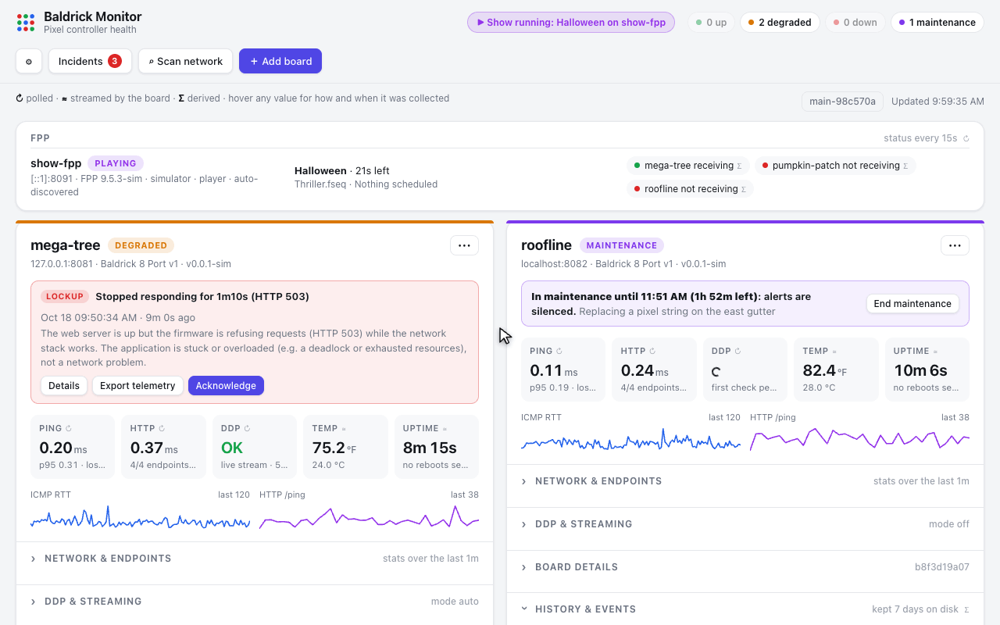
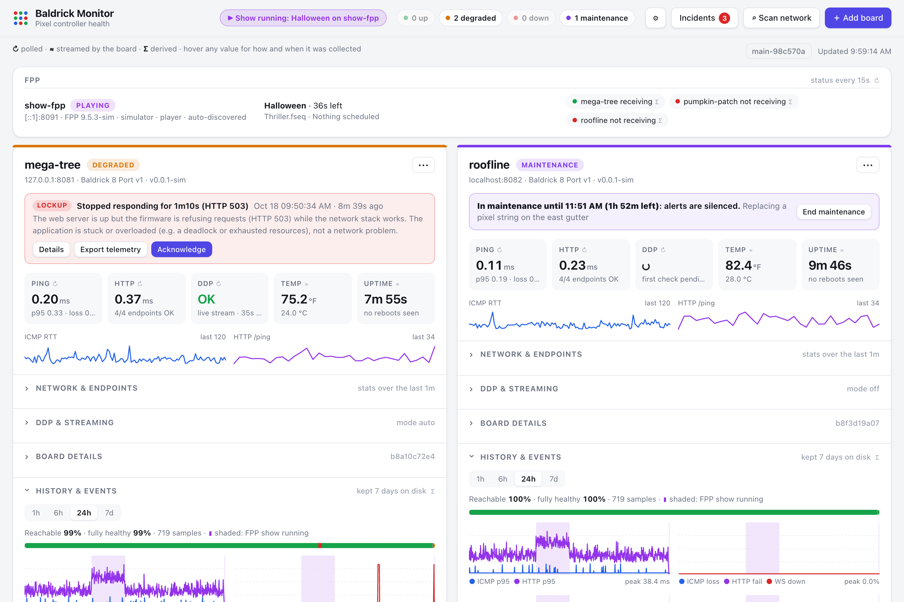
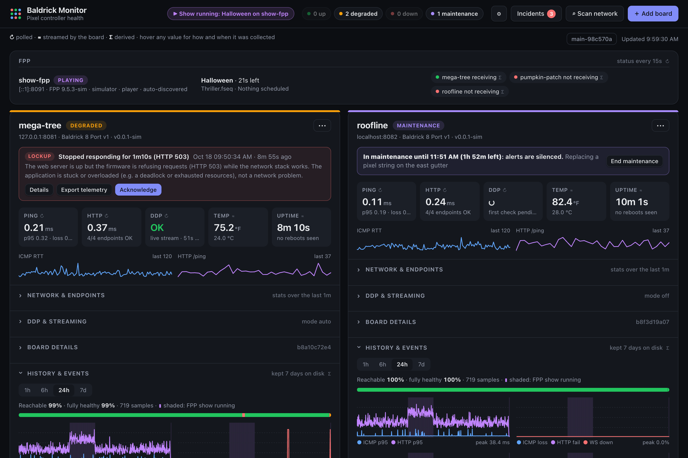
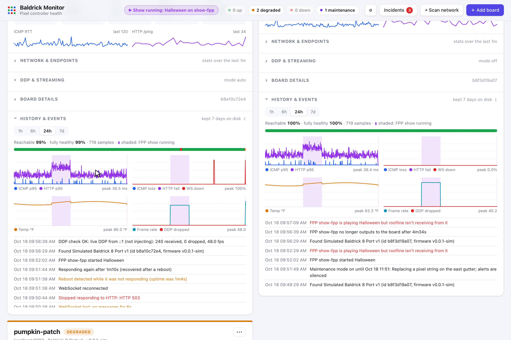
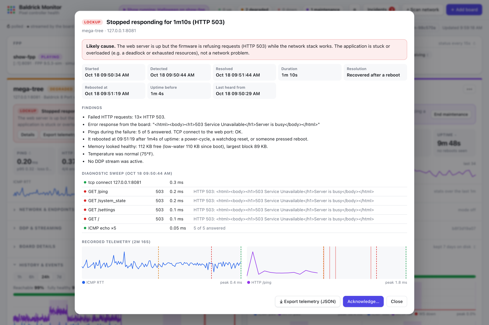
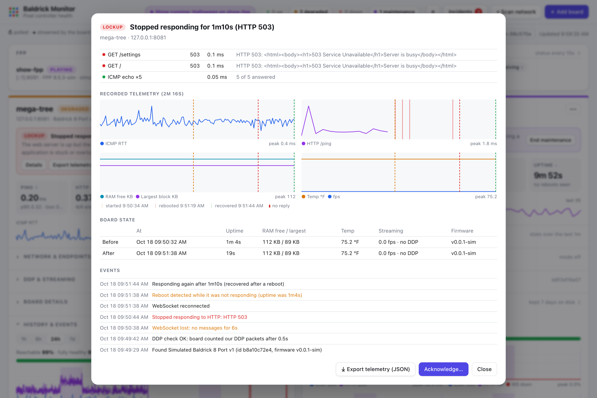
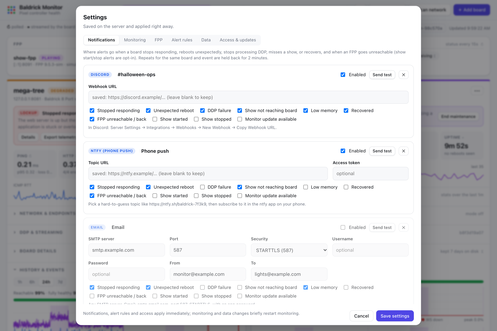
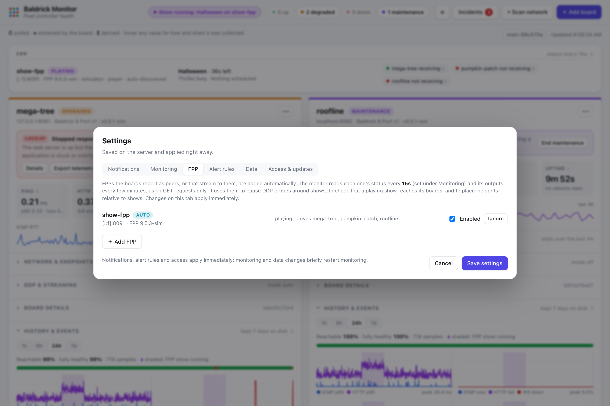

# baldrick-monitor

Monitors [Baldrick Board](https://baldrickboard.com) pixel controllers. It checks
that each board is alive, serving HTTP, and processing DDP, and tracks latency,
jitter and board health. It serves a web dashboard, a JSON API and Prometheus
metrics. It is a single static Go binary with no dependencies.



## Screenshots

These come from the built-in simulator (`cmd/fakeboard`): three simulated
boards and a simulated FPP running a show, with a staged lockup, crash and
maintenance window. The history is generated.

| | |
|---|---|
|  |  |
| **Dashboard.** Fleet summary, "show running" bar, the FPP and which boards are receiving it, one card per board. | **Dark mode** follows your system setting. |
|  |  |
| **Hover any chart** for exact times and values. | **Incidents** explain what happened and how the board failed, with a diagnostic sweep taken while it was failing. |
|  |  |
| **Recorded telemetry** from before and during the incident, ready to export. | **Notifications** to Discord, Slack, email, ntfy or any webhook, each with its own events. |
|  | |
| **FPPs** are found automatically from what your boards report, or added by hand. | |

## What it checks

| Check | How | Kind |
|---|---|---|
| Reachability, latency, jitter, loss | ICMP echo | polled (`intervals.icmp`, default 1s) |
| HTTP liveness | `GET /ping` → 200 + JSON | polled (`intervals.http_ping`, 5s) |
| Web UI served | `GET /` → 200 `text/html` | polled (`intervals.web_ui`, 1m) |
| State API | `GET /system_state` → 200 + JSON with `uptime` | polled (`intervals.system_state`, 15s) |
| Config (hostname, ports/models) | `GET /settings` | polled (`intervals.settings`, 5m) |
| Board state (uptime, temp, RAM, OOM, firmware, frame rate, stream counters, FPP peers) | WebSocket `/ws` (subprotocol `baldrick`); the board pushes deltas, and we send the same `{}` keepalive as its UI | streamed, with the `/system_state` poll as a backstop |
| DDP processing | see below | polled (`intervals.ddp_probe`, 1m) |

Temperatures are shown in °F by default (`"temperature_unit": "C"` to switch).
Thresholds (`temp_warn_c`) and Prometheus metrics stay in Celsius.

Hovering over any chart shows the exact time and values at that point
(sparklines, history charts, the status strip and incident telemetry).

Every value on the dashboard has a hover tooltip. It says whether the value is
polled (↻) or streamed (≋), how often it is collected, and when it last changed
and how: WebSocket push or poll.

### DDP check

The board doesn't answer DDP status/config queries. Its own counters in
`system_state.streaming` (`ddp_recvd`, `ddp_dropped`, `ddp_sources`) are the
source of truth. They cover ~5-second windows, reset when a stream stops,
and ignore a lone packet. `ddp_dropped` counts DDP sequence-number gaps.

`ddp_probe.mode`:

- **`auto`** (default): if another source (e.g. FPP) is already streaming, it
  checks that stream passively and injects nothing. Otherwise it sends a short
  burst (`packets` at `rate`/s) of black frames to DDP byte offset `offset`
  (default 1,000,000), past every configured channel, so no pixel changes. It
  then polls `/system_state` until the board counts them.
- **`always`**: injects even while another source is streaming.
- **`off`**: never injects. Stream counters are still shown.

Set `ddp_probe` on a single board to override the mode for that board.

**Probes and live shows.** In `auto` mode, probes are built to stay out of
a show's way:

- **FPP-aware:** probes wait while any FPP that drives the board (its
  outputs point at it) or that the board reports as a peer is running
  something, or is within 5 minutes of its next scheduled show (see
  [FPP](#fpp)). This covers the gaps between sequences in a playlist. An
  FPP the board reports that hasn't been checked yet holds probes too; an
  unreachable, disabled or ignored one doesn't. Turn it off with
  `ddp_probe.ignore_fpp` (Settings → Monitoring → During shows).
- **Gets out of the way:** if another DDP source appears mid-probe, the
  probe stops sending immediately.
- **Harmless even if they overlap:** probe packets never set DDP's PUSH
  flag, so they can't trigger an output frame. They use sequence number 0
  ("not used"), so they can't show up as dropped packets in a real stream.
  And they write black to an offset past every configured channel. Tested
  on a Baldrick 8 Port v1 (v3.8.9): it counts such packets and lists the
  sender as a source.

When a check is held back, the dashboard shows it as paused (for example
"paused for the show"), keeps the last real result, and doesn't count the
skip as a failure.

### Health

- **down**: `http_fail_down` consecutive `/ping` failures, or no ICMP replies.
- **degraded** if any of:
  - ICMP loss or p95 RTT over threshold;
  - an HTTP endpoint failing;
  - the WebSocket is disconnected;
  - the board state is stale;
  - the last DDP check failed;
  - DDP loss over threshold on an active stream;
  - temperature, the RAM low-water mark, an OOM count, or board UI messages.
- **maintenance** while the board is in maintenance mode (see below), whatever
  else is going on. The reasons are still listed on its card.

Events are logged when any of these happen:

- a reboot, detected by uptime going backwards;
- a firmware or settings change;
- an HTTP outage or recovery;
- a WebSocket drop;
- a DDP check failure or recovery.

**Show output verification.** Probes pause during shows, so instead the
monitor checks that the show actually reaches the board. Every 5 seconds it
looks at what the [FPP pollers](#fpp) last saw: if an FPP is playing and its
channel outputs send DDP, unicast E1.31, unicast Art-Net or KiNET to the
board's address (or its hostname), the board must list that FPP's IP among
its stream sources. If it doesn't for 20 seconds, a **show output** incident
opens; it resolves when the stream appears, or when FPP stops playing or no
longer outputs to the board. Multicast E1.31 and Art-Net broadcast outputs
can't be tied to one board and aren't checked. An FPP that can't be reached
is left alone (it gets its own alert).

## FPP

The monitor watches every FPP that feeds the boards, to cross-reference
board trouble with shows and to know when to stay out of a show's way.

**Finding them.** FPPs are added automatically from:

- every board's `system_state.fpp` peer list;
- any DDP, sACN or Art-Net source a board lists that answers FPP's
  `/api/fppd/status` (asked once, then left alone for 30 minutes if it
  isn't FPP). The monitor's own probe address is skipped.

You can also add one by hand (**⚙ Settings → FPP → Add FPP**, with **Test
connection**), disable one, or remove one. Removing an auto-discovered FPP
keeps it as **ignored** so discovery doesn't bring it back; **Restore**
undoes that. The list lives in `<data_dir>/fpps.json`.

**Polling.** One poller per FPP, using GET requests only:

| What | Endpoint | How often |
|---|---|---|
| Status, mode, playlist, sequence, time remaining, next scheduled show, version, platform | `/api/fppd/status` | `intervals.fpp` (default 15s, Settings → Monitoring) |
| Network outputs, mapped to monitored boards | `/api/channel/output/universeOutputs` | every 5 minutes, and when a show starts |

Three failed polls in a row make an FPP **unreachable**.

**Dashboard.** An FPP panel above the boards shows each FPP's status, what
it's playing and how long is left, its next show, and the boards it drives
with whether each is receiving its stream right now. While any FPP is
playing, the header shows **Show running: <playlist> on <fpp>**; within 5
minutes of a scheduled show it shows **Next show at HH:MM**, so it's clear
why DDP probes are standing aside.

**Cross-referencing.** Show started/stopped and FPP unreachable/back are
recorded as events on the FPP and on every board it drives or that reports
it, and in those boards' flight recorders (`fpp` points). Incident findings
place each incident relative to the shows, e.g. *"Began 2h15m after FPP fpp
stopped Halloween"* or *"Happened during FPP fpp's show Halloween (started
18:00, 1h12m in)"*. Each board's history rollups carry a `show` flag, and
the history charts shade show periods. Each FPP also keeps its own
rollups, events and show log under `<data_dir>/_fpp/<name>/`.

API: `GET /api/fpps`, `POST /api/fpps` (`{"name","host"}`),
`PUT /api/fpps/{name}` (`{"enabled":bool}` or `{"ignored":bool}`),
`DELETE /api/fpps/{name}` (removes a manual entry, ignores an auto one),
`GET /api/fpps/{name}/history?range=24h`, `GET /api/fpps/inspect?host=`.

## Incidents: reboots, lockups, DDP failures and missing shows

When something goes wrong, the monitor opens an **incident** and keeps the
telemetry that led up to it. It keeps a rolling raw recorder (default 30
minutes) of every ping, HTTP check (including error bodies), WebSocket state
update, DDP check and event.

| Incident | Detected when | What it captures |
|---|---|---|
| **Stopped responding** (lockup) | `/ping` fails `http_fail_down` times in a row (503s, timeouts, refused) | An immediate diagnostic sweep (TCP connect; every endpoint's status and error page; 5 pings) to separate "web server up but the firmware refuses (503)", "network stack alive but HTTP hung" and "nothing answers (power/network)". It stays open until HTTP works again and records whether it recovered on its own or only after a reboot. |
| **Reboot** | The board's boot time (now − uptime) jumps forward, including reboots that happened while the monitor was down | Classified as *unexpected*, *firmware update* or *after a settings change* (the last two are auto-acknowledged). Findings cover how the board went quiet (instant crash vs hang vs long outage), memory and leak trends, temperature, active streams, crash loops, and any message the board shows after booting. |
| **Not processing DDP** | Two DDP checks in a row fail while HTTP still works | The probe results and the board's stream counters. |
| **Show output** | An FPP whose outputs include the board is playing, but the board hasn't listed that FPP as a stream source for 20s (not raised during a lockup) | FPP's full status and output config, the outputs aimed at the board, and the board's sources at the time, including any other controller it's receiving from instead. |
| **Manual capture** | **Collect diagnostics now** in a board's ••• menu | The recorder plus a fresh sweep. Use it the moment something looks off. |

An incident keeps the board **degraded** until you **Acknowledge** it, with
an optional note, from the card banner, the **Incidents** list or the detail
view. **Export telemetry** downloads a JSON bundle containing:

- a readable summary;
- the full raw timeline;
- two hours of rollups and events;
- the board's settings;
- the monitor configuration.

Attach it to a bug report. Incidents are kept `incidents.retention_days`
(default 90) under `<data_dir>/<board>/incidents/`.

The board's firmware doesn't expose a reset reason, so the "likely cause" is
inferred from these observations. A reboot started from the board's own web
UI looks the same as a crash.

### Notifications

Set these up in **⚙ Settings → Notifications**. Add any number of channels:

| Channel | What you need |
|---|---|
| **Discord** | A channel webhook URL (Server Settings → Integrations → Webhooks). Alerts arrive as color-coded embeds. |
| **Slack** | An incoming-webhook URL. Alerts arrive as formatted messages with a link. |
| **Email** | Any SMTP server (STARTTLS, TLS or plain), optional login, one or more recipients. |
| **ntfy** | A topic URL such as `https://ntfy.sh/your-random-topic` (or a self-hosted server, with an optional token). It's free push to the ntfy phone app. |
| **Webhook** | Any URL. The alert is POSTed as JSON. |

Each channel picks its events: **stopped responding**, **unexpected
reboot**, **DDP failure**, **show not reaching board**, **low memory** (the board's lowest free memory
since boot fell below `ram_min_warn_bytes`),
**recovered**, **FPP unreachable / back**, and optionally **show started**,
**show stopped** and **monitor update available**. **Send test** checks a channel before you save. Repeats of the
same event for the same board are held back for 2 minutes, so a flapping
board doesn't flood you. Set the **dashboard URL** so alerts link straight
to the incident.

Prometheus also gets `baldrick_incidents_unacknowledged{type}` and
`baldrick_incidents_ongoing{type}`, plus per FPP `baldrick_fpp_up`,
`baldrick_fpp_playing`, `baldrick_fpp_info{version,platform,mode,...}`,
`baldrick_fpp_seconds_remaining`, `baldrick_fpp_next_show_timestamp_seconds`
and `baldrick_fpp_board_receiving{board}`.

### Maintenance mode

Working on a board? Its card's **•••** menu has **Maintenance mode…**: pick
30 minutes, 2 hours or until you turn it off, and add a note if you like.
While a board is in maintenance:

- incidents are still detected and recorded, but nobody is notified (low-memory
  warnings included), and new ones are acknowledged automatically with the
  note "During maintenance", so **Acknowledge all** leaves them as they are;
- its card shows **maintenance** (purple) with an **End maintenance** button,
  and it isn't counted as down or degraded in the header;
- `GET /api/boards` reports it as `"status": "maintenance"` with a
  `maintenance` object (`since`, `until`, `note`), and Prometheus gets
  `baldrick_maintenance{board} 1`.

The window is saved in `boards.json`, so it survives a restart, and it ends
on its own when it runs out. If the board is still not responding (or not
processing DDP) when maintenance ends, that incident is reopened and alerts
then. Editing the board keeps its maintenance window.

API: `PUT /api/boards/{name}/maintenance` with
`{"duration": "2h", "note": "…"}` (an empty duration means until turned
off), and `DELETE /api/boards/{name}/maintenance`.

### Quiet hours

**⚙ Settings → Notifications → Quiet hours** holds notifications during a
daily window, for example 22:00 to 07:00 (an end earlier than the start runs
into the next morning), on the days you pick (a window belongs to the day it
starts on). Times are in the monitor's time zone (`TZ`). When the window ends,
each channel gets what was held for it: the alert itself if there was just
one, otherwise one summary listing them all (a webhook gets
`"event": "digest"` with the original alerts in `held`). Tick **Still send
"Stopped responding" alerts** to let lockups, and their recoveries, through
right away. Every other alert is held, low-memory warnings and the
monitor-update alert included. Held alerts carry over a
settings change but not a restart.

In the config file:

```json
"quiet_hours": {"enabled": true, "start": "22:00", "end": "07:00", "days": [0, 1, 2, 3, 4, 5, 6], "allow_lockups": true}
```

`days` uses 0 for Sunday; leave it out for every day.

## Settings

**⚙ Settings** in the header covers what you'd otherwise edit in the config
file:

- **Notifications:** channels, events, quiet hours, the dashboard URL.
- **Monitoring:** every polling interval, the default DDP check mode, the
  probe offset and burst, and the FPP status interval.
- **FPP:** the FPPs being watched (auto-discovered and added by hand):
  add, disable, ignore or restore them. Changes here apply at once.
- **Alert rules:** down-after-N-failures, loss and latency warnings,
  temperature (in °F or °C) and low-memory thresholds, the display unit.
- **Data:** history and incident retention, rollup resolution, the
  telemetry kept per incident.
- **Access & updates:** set, rotate or remove the admin token; the update
  check interval.

Notifications, rules and access apply immediately. Monitoring and data
changes restart the board monitors for a moment. History, incidents and
ongoing lockups carry over, but the raw incident recorder starts over.

Settings are saved to `<data_dir>/settings.json` (mode 0600, since it holds
webhook URLs and passwords). They override the same keys in the config file;
delete the file to fall back to the config file. Secrets are never sent back
to the browser. Saved values show as "saved", and leaving the field blank
keeps them. Values are range-checked, so you can't set, say, a 1 ms ping.

The listen address and data directory stay in the config file.

## Managing boards

Add, edit and remove boards from the dashboard. Changes apply right away,
with no restart:

- **＋ Add board** takes an IP or hostname. **Test connection** shows which
  board answers there (model, hostname, firmware) before you add it.
- **⌕ Scan network** checks every address in a subnet (up to a /22) for a
  Baldrick web API and lists what it finds, with one-click **Add**. The
  subnets of boards you already monitor are offered as suggestions.
- Each card's **•••** menu has **Edit** (rename, change host or DDP mode;
  a rename keeps the board's history), **Maintenance mode…** (see above) and
  **Remove**, which can optionally delete the stored history.

The board list is saved to `<data_dir>/boards.json`. The `boards` list in the
config file only seeds that file on first start; after that, `boards.json`
is the source of truth. To start over from the config, delete it. Without a
`data_dir`, UI changes are lost on restart.

Set `"admin_token"` in the config to require
`Authorization: Bearer <token>` for these changes and for manual DDP checks.
The dashboard asks for the token once and remembers it in the browser.
Viewing stays open.

API: `POST /api/boards`, `PUT /api/boards/{name}`,
`DELETE /api/boards/{name}?purge=1`, `GET /api/inspect?host=`,
`GET /api/scan?cidr=`.

## History

Every `history.resolution` (default 1m), the monitor rolls up the current
stats and appends them to `<data_dir>/<board>/samples-YYYY-MM-DD.jsonl`.
Events go to `events-YYYY-MM-DD.jsonl`. Files older than
`history.retention_days` (default 7) are deleted. History is reloaded on
restart. Without a `data_dir`, history is kept in memory only.

## Testing without hardware

`cmd/fakeboard` imitates a board's HTTP, WebSocket and DDP interfaces and can
simulate failures:

```bash
go run ./cmd/fakeboard &                       # http://127.0.0.1:8081, DDP on 127.0.0.1:4048
go run . -boards 127.0.0.1:8081
curl -XPOST 'localhost:8081/_sim/hang?secs=60'  # 503 lockup (add &reboot=1 to end in a reboot)
curl -XPOST localhost:8081/_sim/crash           # sudden crash + reboot
curl -XPOST localhost:8081/_sim/leak            # heap drains until it crashes
curl -XPOST localhost:8081/_sim/ddpstall        # stops counting DDP
curl -XPOST 'localhost:8081/_sim/fpp?state=playing&stream=0'  # its FPP plays, stream never arrives
curl -XPOST 'localhost:8081/_sim/fpp?stream=1'  # ...now it does
curl -XPOST 'localhost:8081/_sim/fpp?start_in=120'  # schedules a show in 2 minutes
curl -XPOST 'localhost:8081/_sim/fpp?down=1'    # its FPP stops answering (down=0 to recover)
curl -XPOST localhost:8081/_sim/reset
```

The fake board reports itself as its FPP peer (`fakefpp`), serves FPP's
status and output endpoints, and rejects anything but GET there, so the
monitor discovers it and every FPP feature can be exercised.

A board address can include a port (`host:port`). The port applies to HTTP
and the WebSocket; ICMP and DDP always go to the host.

## Running

```bash
go run . -boards 192.168.6.4            # quick look, defaults
go run . -config config.json            # see config.example.json
```

The dashboard is at `http://host:8420/`. Other endpoints:

- `GET /metrics`: Prometheus metrics (`baldrick_*`)
- `GET /api/boards`: live state of every board
- `GET /api/boards/{name}/history?range=24h`
- `POST /api/boards/{name}/probe`: run a DDP check now
- `PUT`/`DELETE /api/boards/{name}/maintenance`: start or end maintenance mode
- `GET /api/fpps`: every FPP and what it's doing
- `GET /api/meta`: intervals, retention, and how each value is collected
- `GET /healthz`

ICMP needs root or `CAP_NET_RAW` on Linux (it falls back to unprivileged
datagram ICMP where allowed, e.g. macOS).

## Deploying with Podman Quadlet

Images are published to `ghcr.io/terensapp/baldrick-monitor` for amd64 and
arm64:

| Tag | Built from |
|---|---|
| `main` | every push to `main` |
| `sha-<commit>` | that commit |
| `latest`, `X.Y`, `X.Y.Z` | release tags `vX.Y.Z` |

A push that only changes docs, deploy scripts, the simulator or the workflow
runs the tests but doesn't publish an image, so it won't appear as an update.

On the host, from a checkout of this repo:

```bash
sudo ./deploy/install.sh               # track :main
sudo ./deploy/install.sh --tag latest  # or track releases only
```

This installs:

- the Quadlet, as `/etc/containers/systemd/baldrick-monitor.container`
  (host networking, `CAP_NET_RAW` for ICMP, your host's timezone);
- a starter `/etc/baldrick-monitor/config.json`, if there isn't one;
- the host updater;
- a firewalld rule for port 8420.

Re-running the script is safe. It keeps your config and data.

### Updating from the dashboard

The monitor checks the registry every `updates.check_interval` (default 6h)
for the image its tag points at. When a newer build exists, the header shows
**Update available**. **Update now** only drops a request file into the data
volume. On the host, `baldrick-monitor-update.path` runs
`/usr/local/libexec/baldrick-monitor-update`, which:

1. pulls the image named in the Quadlet's `Image=` (the container never
   chooses what gets pulled);
2. restarts the service;
3. waits for `/healthz`, and rolls back to the previous image if the new
   one doesn't come up.

Progress and the result appear in the update dialog. The updater's log is in
`journalctl -u baldrick-monitor-update`. Without the host updater installed,
the dashboard still shows when an update is available.

### Cutting a release

```bash
git tag v0.2.0 && git push origin v0.2.0
```

## Prometheus

```yaml
scrape_configs:
  - job_name: baldrick
    static_configs:
      - targets: ["srv:8420"]
```

Useful alerts: `baldrick_up == 0 unless on(board) baldrick_maintenance == 1`, `baldrick_ddp_probe_success == 0`,
`increase(baldrick_reboots_detected_total[1h]) > 0`,
`baldrick_icmp_loss_ratio > 0.05`, `baldrick_temperature_celsius > 70`.
